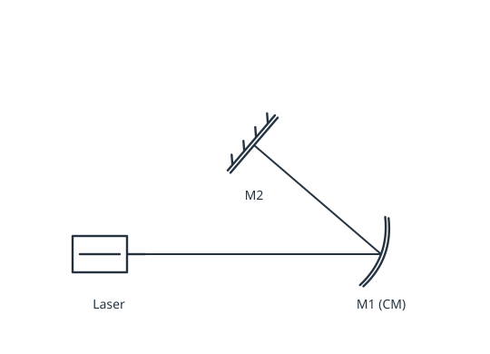

# Inkscape Optical Elements

An Inkscape extension for drawing free-space optical systems with a drag-and-drop symbol gallery, grid snapping, attached connections, arbitrary rotation, and automatic mirror alignment.

**Version 0.6.0 · experimental pre-release · MIT license**

The library contains **63 symbols and 11 editable layouts** for linear and nonlinear optics, cavities, and interferometers. The extension opens its own editor window from Inkscape's Extensions menu. Inkscape waits until you apply or cancel.

## Install

1. Download this repository using **Code → Download ZIP**, then extract it.
2. In Inkscape, open **Preferences → System** and find **User extensions**.
3. Copy the entire **optical_elements_builder** folder into that directory.
4. Restart Inkscape. Choose **Extensions → Optical Elements → Build System…**.

Copy only the installable folder, not the whole repository. Keep its Python files, JSON files, and `optical_builder` subfolder together. No installer or standalone application is included.

**Runtime requirement:** Inkscape's selected Python interpreter must provide Python 3.9+ and Tkinter. Copying the folder does not install Python or Tk. Development and regression checks used macOS, Inkscape 1.4.4, Python 3.14.7, and Tk 8.6. Other versions and Windows/Linux have not been validated for this release. See the [PDF guide](documentation/User_Guide.pdf) for troubleshooting.

## First drawing

Drag components onto the grid, then drag between their blue ports. Shift-click or drag a rectangle from blank canvas to select several components; drag a selected component to move them together. Connections follow.

Mirrors follow connected beam directions automatically. Use **Align optics** to restore automatic alignment. For manual rotation, select one component, enter any finite angle in **Angle °**, and press **Set angle**. This switches off **Follow beams** for that component until you enable it again.

Choose **Apply to Inkscape**, then save your SVG. To edit again, select the system and reopen **Build System…**. Keep the generated group intact and retain the SVG as your editable master.

## Documentation and examples

| File | Purpose |
|---|---|
| [User_Guide.pdf](documentation/User_Guide.pdf) | Installation, illustrated example, editing, alignment, saving, troubleshooting, and license |
| [Symbol_Reference.md](documentation/Symbol_Reference.md) | All 63 symbols and 11 layouts, labels, ports, and references |
| [simple_mirror_system.svg](examples/simple_mirror_system.svg) | Editable laser, concave folding mirror, and plane end mirror |
| [mach_zehnder.svg](examples/mach_zehnder.svg) | Editable interferometer example |
| [Example instructions](examples/README.md) | How to open and modify both examples |

## License, scope, and attribution

Copyright © 2026 Blas Manuel Rodríguez Lara and contributors. Original project code, symbol data, examples, and documentation use the [MIT license](LICENSE). Preserve its copyright and permission notice when redistributing copies or substantial portions. Third-party components retain their own licenses; see [THIRD_PARTY_NOTICES.md](THIRD_PARTY_NOTICES.md).

**Caveat emptor:** the software is provided **as is**, without warranty. It draws schematics and adjusts local symbol orientations; it does not simulate or certify an optical system. Templates are starting points, not validated optical prescriptions. Read [DISCLAIMER.md](DISCLAIMER.md) before relying on a drawing.

This is an independent extension, not an official Inkscape product. The runtime makes no network requests and contains no telemetry or automatic updater. Its readable Python source is included in the installable folder.

## Feedback and reuse

When reporting a problem, include your operating system, Inkscape version, Python/Tk version if known, exact error, and a minimal SVG you may share. Remove private document content first. A response or maintenance schedule is not guaranteed.

Academic acknowledgment is welcome but is not an additional license condition. Citation metadata is provided in [CITATION.cff](CITATION.cff). No DOI or repository URL is assigned in this package.

To update, close Inkscape, keep a backup of the old extension and your SVGs, replace the installed `optical_elements_builder` folder, and restart. To uninstall, remove that folder and restart; saved drawings remain SVG files.

The PDF source and its vector figures are in `documentation/`. Build instructions are in [documentation/README.md](documentation/README.md). No build step is needed to install or use the extension.
